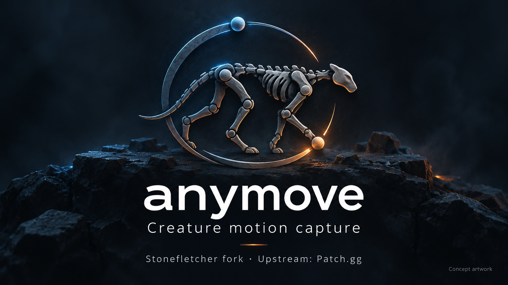
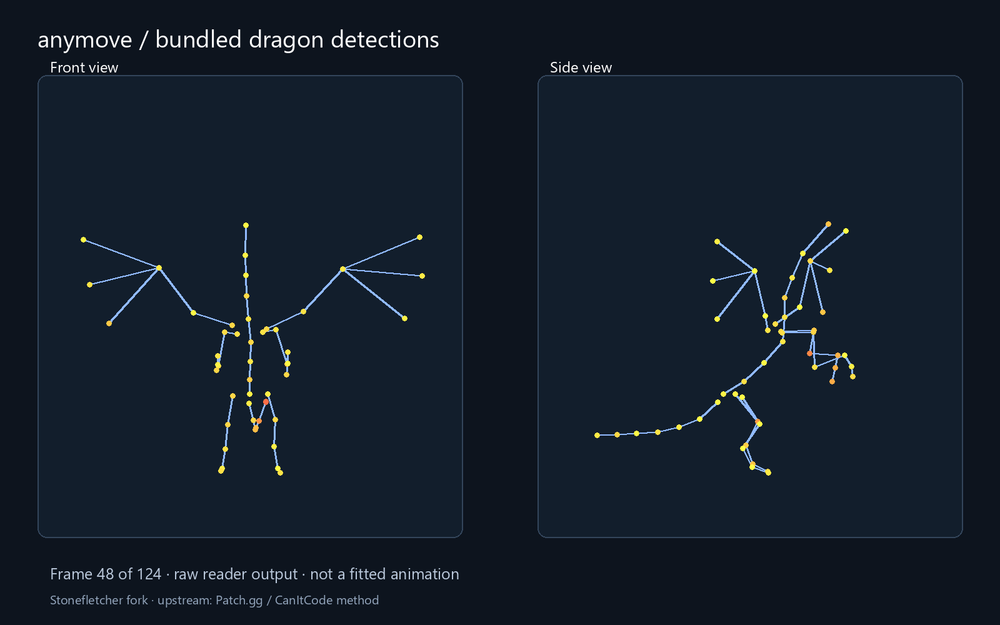

# anymove: refreshed imagery

New concept branding and a fresh interface capture or data view, prepared October 29, 2026.

Fresh visualization of bundled raw detections at frame 48 of 124; not a screenshot, new inference, solve or animation. Upstream Patch.gg / CanItCode credit retained.

The banner is AI-generated symbolic brand artwork, not a product screenshot or a promise of output quality. The original generated PNG is preserved. [Exact prompt](PROMPT.txt) · [Source revision, input and output fingerprints](provenance.json).

This is artwork for the Stonefletcher fork, not a replacement for upstream branding. See [Patch.gg](https://github.com/Patch-gg/anymove) and the original method/author credits in the repository README. Rebuild the data view with `python marketing/render_detections.py` (NumPy and Pillow). No paid API calls, training, inference or fitting were performed.
